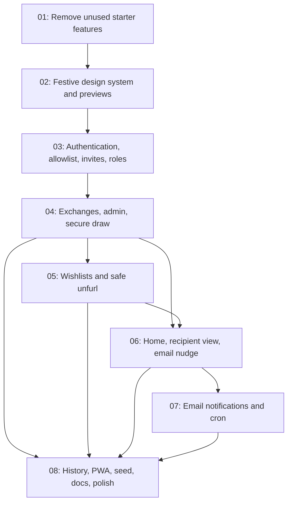

# Secret Santa Application

## Overview

Build the production-ready family and friends Secret Santa application described in the source requirements. The work is organized into the seven requested waves, with an explicit visual review stop after Wave 1 previews and before any product workflows are implemented.

## Quick Links

- [Requirements](./requirements.md) — source requirements, plan, schema proposal, and acceptance criteria
- [Action Required](./action-required.md) — external setup and human steps
- [Source spec](../secret-santa-spec.md) — original product requirements

## Dependency Graph

## Waves

| Wave | Tasks | Description |
|------|-------|-------------|
| 1 | task-01, task-02 | Remove unused starter features, build the festive design system and preview pages, then stop for visual review. |
| 2 | task-03 | Add Google and magic-link authentication, allowlist/invite onboarding, roles, and authorization foundations. |
| 3 | task-04 | Build admin/exchange management, secure draw and assignment persistence, audit logging, and draw tests. |
| 4 | task-05 | Build per-exchange wishlists, claims, copy-forward, safe URL unfurl, and related tests. |
| 5 | task-06 | Build Home/recipient experiences and an email nudge for recipients with gift ideas. |
| 6 | task-07 | Add Resend templates, daily notification scheduling, idempotency, and protected Vercel Cron. |
| 7 | task-08 | Add history, PWA installation, seed data, setup documentation, and integration polish. |

## Task Status

### Wave 1
- [x] [task-01-remove-starter-features](./tasks/task-01-remove-starter-features.md) — Remove unused chat, payments, blob, and API-key starter features; add Vitest.
- [x] [task-02-design-system-and-previews](./tasks/task-02-design-system-and-previews.md) — Build festive tokens, shared shell/components, and visual previews; pause for review.

### Wave 2
- [x] [task-03-auth-access-and-invites](./tasks/task-03-auth-access-and-invites.md) — Google/magic-link auth, invitation eligibility, roles, route access, and migrations complete.

### Wave 3
- [x] [task-04-admin-exchanges-and-draw](./tasks/task-04-admin-exchanges-and-draw.md) — Admin workflows, exchanges, secure draw, audit, tests, and migrations complete.

### Wave 4
- [x] [task-05-wishlists-and-unfurl](./tasks/task-05-wishlists-and-unfurl.md) — Wishlist management, claims, URL unfurl, SSRF tests, and live database migration complete.

### Wave 5
- [x] [task-06-home-recipient-and-nudge](./tasks/task-06-home-and-nudge.md) — Participant Home and recipient email nudge complete; messaging remains out of scope.

### Wave 6
- [x] [task-07-email-and-cron](./tasks/task-07-email-and-cron.md) — Notification emails, preferences, idempotent delivery, and protected daily cron complete.

### Wave 7
- [ ] [task-08-history-pwa-seed-and-docs](./tasks/task-08-history-pwa-seed-and-docs.md) — Add past exchange history, PWA support, sample data, documentation, and final polish.

## Approval Gate

Review the task files and `action-required.md`. Implementation is not authorized until the user approves the task plan and says when to start Wave 1. After Wave 1, render and capture the required preview combinations and stop for the user's visual review before Wave 2.
